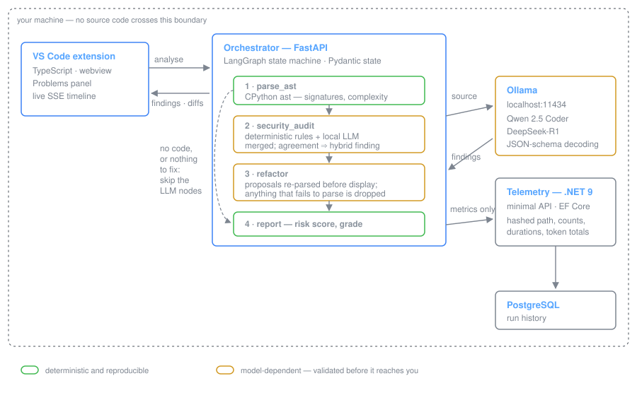

<h1 align="center">Code Modernization &amp; Security Studio</h1>

<p align="center">
  <strong>Multi-agent security auditing and semantic refactoring that never sends your code anywhere.</strong>
</p>

<p align="center">
  <a href="#"></a>
  
  
  
  
</p>

---

A VS Code extension and local service that analyse a source file with three
specialised agents — an AST profiler, a security auditor and a refactoring
engineer — orchestrated as a [LangGraph](https://github.com/langchain-ai/langgraph)
state machine. Every inference call goes to a local [Ollama](https://ollama.com)
host. Source code never leaves the machine, and the service refuses to start
against a non-local inference endpoint.

<p align="center">
  
</p>

## Why it is built this way

Three decisions account for most of the design. Each exists because the naive
alternative failed in practice.

### Deterministic detectors run first, and always

Pattern-matchable weaknesses — `eval`, `shell=True`, SQL string concatenation,
hard-coded secrets, broken hashes — are found by an AST ruleset that is
instant, free and reproducible. The language model is then told what the
scanner already found and asked for the *complement*: missing authorisation,
trust-boundary mistakes, unsafe defaults, flawed validation logic.

This ordering buys three things. CI gating becomes meaningful, because the
deterministic half of the report does not change with sampling temperature.
The model spends its context on what a matcher cannot see instead of
re-deriving that `eval` is dangerous. And when Ollama is unavailable the run
degrades rather than fails — the nodes report `degraded`, the deterministic
findings still arrive, and the report is still useful.

When both detectors independently flag the same line, the finding is promoted
to `hybrid` with raised confidence. Two independent detectors agreeing is the
strongest signal this system can produce.

### Generated code is validated, never trusted

Every refactor proposal is re-parsed by the AST backend before it is shown.
Anything that fails to parse is discarded with a warning rather than
displayed. A 7B model producing *plausible but syntactically invalid* code is
the normal failure mode, and the user must never be the one to catch it.

This is necessary but, as [the evaluation](docs/EVALUATION.md) documents, not
sufficient — a syntactically valid refactor can still change behaviour. See
[the roadmap](#roadmap).

### Schema-constrained decoding, not prompt-and-pray

Ollama's `format` parameter accepts a JSON Schema and constrains generation at
the sampler. A small model asked politely for JSON drifts; a small model that
*cannot emit* invalid JSON does not. Pydantic models serve as both the
constraint and the validator, and a schema violation is re-prompted with the
validator's own error message.

## What it does

| | |
| --- | --- |
| **Complexity profiling** | Cyclomatic, cognitive, nesting depth, Halstead volume and maintainability index, per function. Nested functions are profiled separately rather than smeared onto the parent. |
| **Security auditing** | A deterministic AST ruleset (CWE-tagged, OWASP-mapped) plus a local LLM pass, merged and de-duplicated. |
| **Semantic refactoring** | Targets selected by measured complexity and finding severity — not by asking the model what it feels like improving. Every proposal is syntax-validated. |
| **IDE integration** | Findings land in the native Problems panel; a webview renders the live agent timeline, streamed as server-sent events. |
| **Telemetry** | Run metrics to a .NET service backed by PostgreSQL. Metrics only: a hashed file path, counts, durations and token totals. |

## Quick start

```bash
# 1. Models (once)
ollama pull qwen2.5-coder:7b

# 2. The service
cd services/orchestrator
python -m venv .venv && source .venv/bin/activate   # Windows: .venv\Scripts\activate
pip install -e ".[dev]"
uvicorn app.main:app --reload                       # http://localhost:8000/docs

# 3. Analyse something
curl -s localhost:8000/api/v1/analysis/run \
  -H 'content-type: application/json' \
  -d '{"file_path":"demo.py","source_code":"def f(u, c):\n    c.execute(\"SELECT * FROM t WHERE n = \" + u)\n"}'
```

Or run the whole stack — orchestrator, telemetry service and PostgreSQL:

```bash
cp .env.example .env
docker compose up --build
```

`GET /health/ready` reports whether Ollama is reachable and names any
configured model that has not been pulled.

For the VS Code extension and the standalone complexity profiler, see
[docs/DEVELOPMENT.md](docs/DEVELOPMENT.md).

## The pipeline

```
START → parse_ast ─┬─(no code)──────────────────────────────┐
                   └→ security_audit ─┬─(nothing to fix)───┐│
                                      └→ refactor ─────────┴┴→ report → END
```

Both conditional edges exist to protect latency. An empty file, a clean file
and a file that does not parse all skip the LLM nodes entirely — a full agent
run costs 30–90 seconds on consumer hardware, so not spending it is a feature.

The audit and refactor stages are sequential rather than parallel on purpose:
the refactor agent needs the audit's findings to prioritise targets, and
Ollama serialises requests anyway, so a fan-out would double peak VRAM for no
latency gain.

State is a Pydantic model used directly as the LangGraph state schema, so
every partial update a node returns is validated at the boundary. Accumulating
fields carry reducers; scalars are last-write-wins.

## API

| Method | Path | Purpose |
| --- | --- | --- |
| `GET` | `/health` | Liveness |
| `GET` | `/health/ready` | Ollama reachability and missing models |
| `POST` | `/api/v1/analysis/parse` | Metrics only — milliseconds, no inference |
| `POST` | `/api/v1/analysis/run` | Full pipeline, awaited |
| `POST` | `/api/v1/analysis/stream` | Full pipeline as server-sent events |
| `GET` | `/api/v1/analysis/{run_id}` | Replay a checkpointed run |

Interactive documentation at `/docs`. The telemetry service exposes
`POST /api/v1/runs`, `GET /api/v1/runs` and `GET /api/v1/summary?days=30`.

## Data handling

| Destination | What goes there |
| --- | --- |
| Ollama, on localhost | Source code, for inference only |
| PostgreSQL | A truncated SHA-256 of the file path, counts, durations, token totals |
| Anywhere else | Nothing |

`CMS_OFFLINE_ONLY=true` — the default — makes the orchestrator refuse to start
against an inference endpoint that is not loopback or private-network. The
zero-leakage property is enforced in code, not just documented.

## Project layout

```
codemod-studio/
├── services/
│   ├── orchestrator/          # Python — FastAPI + LangGraph
│   │   ├── app/
│   │   │   ├── schemas/       # agent_state.py — the LangGraph state model
│   │   │   ├── analysis/      # AST backend, metrics, deterministic rules
│   │   │   ├── llm/           # Ollama client, schema-constrained prompts
│   │   │   ├── agents/        # graph.py + one module per node
│   │   │   ├── telemetry/     # client for the .NET sidecar
│   │   │   └── api/           # routers, dependency wiring
│   │   ├── scripts/           # standalone complexity profiler / CI gate
│   │   └── tests/             # 56 tests, no network required
│   └── telemetry-api/         # .NET 9 minimal API + EF Core
└── clients/vscode-extension/  # TypeScript extension + webview
```

## Development

```bash
make test        # pytest, against a stubbed inference client
make lint        # ruff + eslint
make typecheck   # mypy --strict + tsc --strict
make analyze     # the profiler run over its own source
```

The test suite exercises the real compiled graph — routing, state reducers,
finding merges, proposal validation — against a deterministic `StubLlm` that
implements the same protocol as the real client. Because the nodes depend on
that protocol rather than a concrete class, no test needs Ollama running, and
no test is flaky.

CI additionally runs the complexity profiler over the orchestrator's own
source with a cyclomatic ceiling of 15, which fails the build if the tool
would flag its own code.

More in [docs/DEVELOPMENT.md](docs/DEVELOPMENT.md).

## Status

Phases 1 and 2 are complete: the pipeline, the AST engine, the telemetry
service and the IDE client all run end to end against local models.

What this means in practice, stated plainly because it bears on how the output
should be read: the deterministic detectors are reliable, and the agent layer
is not yet. On the sample corpus a 7B model contributed one useful finding out
of three, with the other two hallucinated at maximum reported confidence, and
produced a syntactically valid refactor that silently changed behaviour. The
numbers and the method are in [docs/EVALUATION.md](docs/EVALUATION.md). Those
measurements are what the roadmap below is built around.

## Roadmap

- **Phase 3 — more languages.** Tree-sitter backends for TypeScript, C# and Go.
  The `SourceAnalyzer` interface and its registry are already in place; adding
  a backend is one `register()` call.
- **Phase 4 — verified refactoring.** A test-generation agent that synthesises
  pytest cases against the original function, runs them against the proposal
  in a sandbox, and surfaces only refactors that pass. This turns
  `behaviour_preserved` from a model's claim into a checked fact, and is the
  single highest-value item on this list.
- **Phase 5 — repository scale.** Call-graph construction, cross-file taint
  tracking, and durable Postgres-backed checkpointing.

## Documentation

- [Architecture](docs/ARCHITECTURE.md) — the design decisions in depth
- [Evaluation](docs/EVALUATION.md) — measured local-model behaviour
- [Development](docs/DEVELOPMENT.md) — setup, testing, troubleshooting

## Licence

[MIT](LICENSE).
